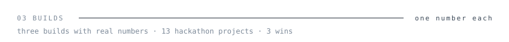
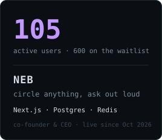
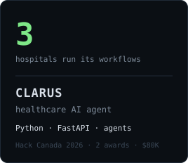
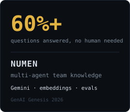

  

  <a href="https://www.linkedin.com/in/mohammed-faraz-kabbo/"><b>LINKEDIN</b></a>
  &nbsp;&nbsp;·&nbsp;&nbsp;
  <a href="https://farazkabbo.github.io/Portfolio/"><b>PORTFOLIO</b></a>
  &nbsp;&nbsp;·&nbsp;&nbsp;
  <a href="https://myneb.si"><b>NEB</b></a>
  &nbsp;&nbsp;·&nbsp;&nbsp;
  <a href="https://devpost.com/farazkabbo"><b>DEVPOST</b></a>
  &nbsp;&nbsp;·&nbsp;&nbsp;
  <a href="mailto:faraz18@my.yorku.ca"><b>EMAIL</b></a>

  

  

  
  
  

  <picture>
    <source media="(prefers-color-scheme: dark)" srcset="https://raw.githubusercontent.com/farazkabbo/farazkabbo/output/github-snake-dark.svg" />
    <source media="(prefers-color-scheme: light)" srcset="https://raw.githubusercontent.com/farazkabbo/farazkabbo/output/github-snake.svg" />
    
  </picture>

