<a href="https://farazkabbo.github.io/Portfolio/"><picture><source media="(prefers-color-scheme: dark) and (max-width: 600px)" srcset="assets/hero-phone-dark.svg"><source media="(max-width: 600px)" srcset="assets/hero-phone-light.svg"><source media="(prefers-color-scheme: dark)" srcset="assets/hero-dark.svg">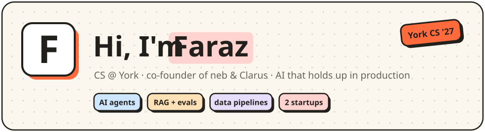</picture></a>

<a href="https://www.linkedin.com/in/mohammed-faraz-kabbo/"><picture><source media="(prefers-color-scheme: dark)" srcset="assets/badge-linkedin-dark.svg"></picture></a>
<a href="https://farazkabbo.github.io/Portfolio/"><picture><source media="(prefers-color-scheme: dark)" srcset="assets/badge-portfolio-dark.svg"></picture></a>
<a href="https://myneb.si"><picture><source media="(prefers-color-scheme: dark)" srcset="assets/badge-neb-dark.svg">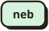</picture></a>
<a href="https://devpost.com/farazkabbo"><picture><source media="(prefers-color-scheme: dark)" srcset="assets/badge-devpost-dark.svg"></picture></a>
<a href="mailto:faraz18@my.yorku.ca"><picture><source media="(prefers-color-scheme: dark)" srcset="assets/badge-email-dark.svg"></picture></a>

<picture><source media="(prefers-color-scheme: dark) and (max-width: 600px)" srcset="assets/github-phone-dark.svg"><source media="(max-width: 600px)" srcset="assets/github-phone-light.svg"><source media="(prefers-color-scheme: dark)" srcset="assets/github-dark.svg">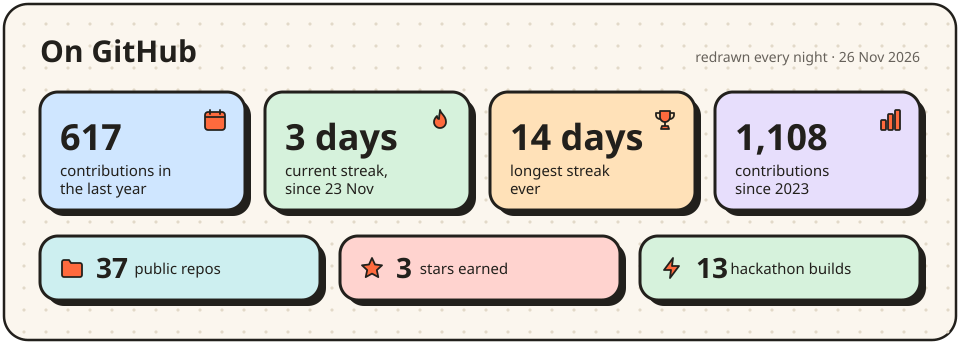</picture>

<picture><source media="(prefers-color-scheme: dark) and (max-width: 600px)" srcset="assets/graph-6m-phone-dark.svg"><source media="(max-width: 600px)" srcset="assets/graph-6m-phone-light.svg"><source media="(prefers-color-scheme: dark)" srcset="assets/graph-6m-dark.svg">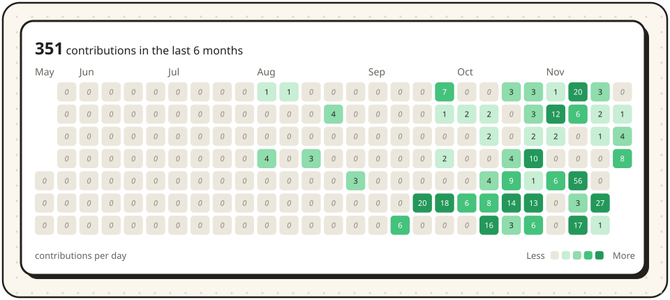</picture>

Last 12 months: 617 contributions

<picture><source media="(prefers-color-scheme: dark) and (max-width: 600px)" srcset="assets/graph-12m-phone-dark.svg"><source media="(max-width: 600px)" srcset="assets/graph-12m-phone-light.svg"><source media="(prefers-color-scheme: dark)" srcset="assets/graph-12m-dark.svg">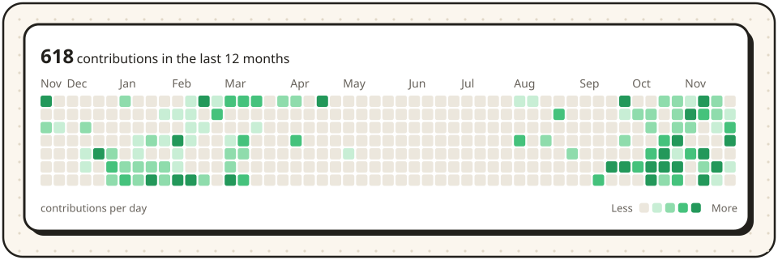</picture>

2026: 574 contributions

<picture><source media="(prefers-color-scheme: dark) and (max-width: 600px)" srcset="assets/graph-2026-phone-dark.svg"><source media="(max-width: 600px)" srcset="assets/graph-2026-phone-light.svg"><source media="(prefers-color-scheme: dark)" srcset="assets/graph-2026-dark.svg">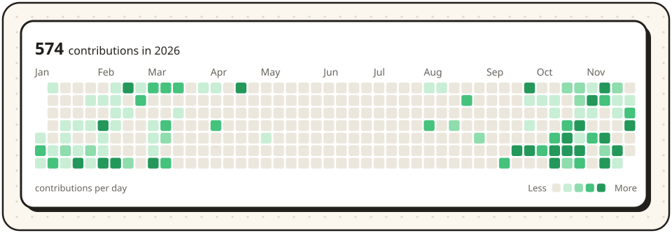</picture>

2025: 249 contributions

<picture><source media="(prefers-color-scheme: dark) and (max-width: 600px)" srcset="assets/graph-2025-phone-dark.svg"><source media="(max-width: 600px)" srcset="assets/graph-2025-phone-light.svg"><source media="(prefers-color-scheme: dark)" srcset="assets/graph-2025-dark.svg">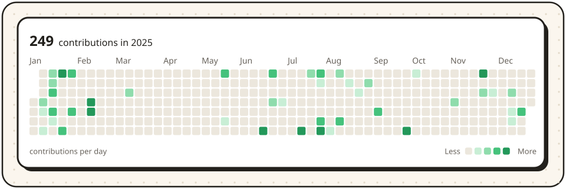</picture>

2024: 284 contributions

<picture><source media="(prefers-color-scheme: dark) and (max-width: 600px)" srcset="assets/graph-2024-phone-dark.svg"><source media="(max-width: 600px)" srcset="assets/graph-2024-phone-light.svg"><source media="(prefers-color-scheme: dark)" srcset="assets/graph-2024-dark.svg">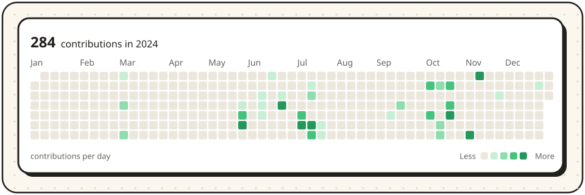</picture>

2023: 1 contribution

<picture><source media="(prefers-color-scheme: dark) and (max-width: 600px)" srcset="assets/graph-2023-phone-dark.svg"><source media="(max-width: 600px)" srcset="assets/graph-2023-phone-light.svg"><source media="(prefers-color-scheme: dark)" srcset="assets/graph-2023-dark.svg">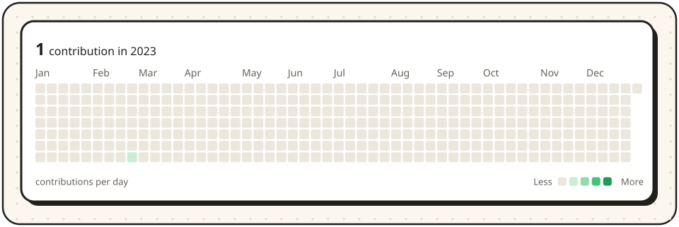</picture>

<picture><source media="(prefers-color-scheme: dark) and (max-width: 600px)" srcset="assets/line-30d-phone-dark.svg"><source media="(max-width: 600px)" srcset="assets/line-30d-phone-light.svg"><source media="(prefers-color-scheme: dark)" srcset="assets/line-30d-dark.svg">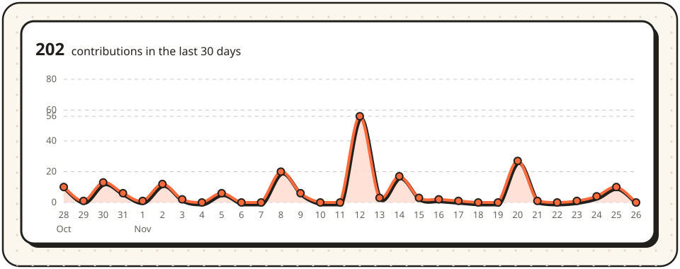</picture>

<picture><source media="(prefers-color-scheme: dark) and (max-width: 600px)" srcset="assets/whoami-phone-dark.svg"><source media="(max-width: 600px)" srcset="assets/whoami-phone-light.svg"><source media="(prefers-color-scheme: dark)" srcset="assets/whoami-dark.svg"></picture>

<picture><source media="(prefers-color-scheme: dark) and (max-width: 600px)" srcset="assets/label-ship-phone-dark.svg"><source media="(max-width: 600px)" srcset="assets/label-ship-phone-light.svg"><source media="(prefers-color-scheme: dark)" srcset="assets/label-ship-dark.svg"></picture>

<a href="https://myneb.si"><picture><source media="(prefers-color-scheme: dark) and (max-width: 600px)" srcset="assets/app-neb-phone-dark.svg"><source media="(max-width: 600px)" srcset="assets/app-neb-phone-light.svg"><source media="(prefers-color-scheme: dark)" srcset="assets/app-neb-dark.svg">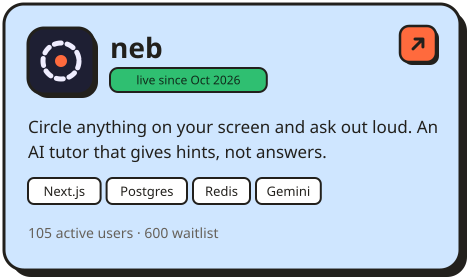</picture></a>
<a href="https://devpost.com/software/clarus-7werym"><picture><source media="(prefers-color-scheme: dark) and (max-width: 600px)" srcset="assets/app-clarus-phone-dark.svg"><source media="(max-width: 600px)" srcset="assets/app-clarus-phone-light.svg"><source media="(prefers-color-scheme: dark)" srcset="assets/app-clarus-dark.svg">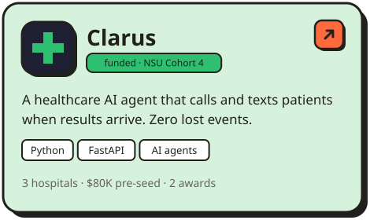</picture></a>
<a href="https://devpost.com/software/numen-9l43wx"><picture><source media="(prefers-color-scheme: dark) and (max-width: 600px)" srcset="assets/app-numen-phone-dark.svg"><source media="(max-width: 600px)" srcset="assets/app-numen-phone-light.svg"><source media="(prefers-color-scheme: dark)" srcset="assets/app-numen-dark.svg">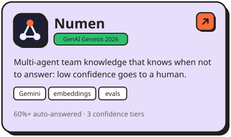</picture></a>
<a href="https://devpost.com/software/vroomi"><picture><source media="(prefers-color-scheme: dark) and (max-width: 600px)" srcset="assets/app-vroomi-phone-dark.svg"><source media="(max-width: 600px)" srcset="assets/app-vroomi-phone-light.svg"><source media="(prefers-color-scheme: dark)" srcset="assets/app-vroomi-dark.svg">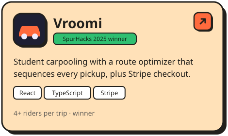</picture></a>

more builds: <a href="https://devpost.com/software/mimicoo">Mimicoo</a> · <a href="https://github.com/farazkabbo/fastpipe">fastpipe</a> · <a href="https://devpost.com/farazkabbo">all 13 builds on Devpost</a>

<picture><source media="(prefers-color-scheme: dark)" srcset="https://raw.githubusercontent.com/farazkabbo/farazkabbo/output/github-snake-dark.svg"></picture>

Drawn as a sticker board · numbers redrawn every night by a GitHub Action · <a href="https://farazkabbo.github.io/Portfolio/">farazkabbo.github.io/Portfolio</a>

